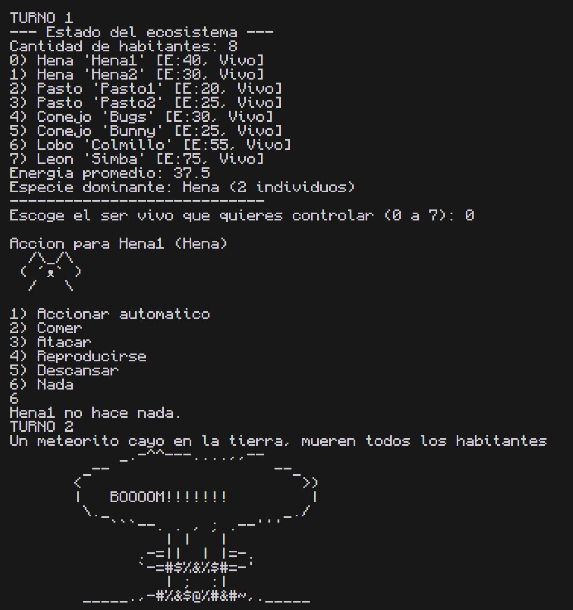

# Ecosystem Simulation (C++)

An interactive, turn-based ecosystem where plants, rabbits and predators interact. Built for my Object-Oriented Programming course at Universidad de Monterrey (UDEM).



## What it does

Each turn you pick one living being and choose what it does:

- **Act automatically:** animals burn energy based on their metabolism, plants grow.
- **Eat:** rabbits eat plants (Hena, Pasto) and gain energy from them.
- **Attack:** wolves and lions attack rabbits; a lion deals 20 damage and recovers half as energy.
- **Reproduce:** two beings of the same species with enough energy create offspring.
- **Rest or do nothing.**

Beings that run out of energy die. Every turn there is a 10% chance of a meteorite that wipes out the ecosystem. The program also prints the number of inhabitants, the average energy and the dominant species.

## Concepts used

- **Inheritance and an abstract base class:** `SerVivo` defines pure virtual methods; `Animal` and `Planta` extend it, and `Conejo`, `Lobo`, `Leon`, `Hena` and `Pasto` extend those.
- **Polymorphism:** the main loop works with `SerVivo*` pointers and calls `comer`, `atacar`, `reproducirse` and `dibujo` without knowing the concrete species.
- **Class template:** `Ecosistema<T>` stores and summarizes the inhabitants.
- **Operator overloading:** `==` compares species and `+` creates offspring.
- **Dynamic memory:** beings are created with `new` and released with `delete` when they die.

## Project structure

| File | Role |
|---|---|
| `main.cpp` | Game loop, menu and random meteorite |
| `SerVivo.h` | Abstract base class |
| `Animal2.h`, `Planta.h` | Intermediate classes |
| `Conejo.h`, `Lobo.h`, `Leon.h` | Animal species |
| `Hena.h`, `Pasto.h` | Plant species |
| `Ecosistema.h` | Class template that holds the inhabitants |

## How to run

```
g++ -std=c++17 main.cpp -o ecosystem
./ecosystem
```

The interface text is in Spanish.

## What I learned

Designing a class hierarchy so that new species can be added without touching the main loop, and managing object lifetimes manually with raw pointers.

## Possible improvements

Replace raw pointers with smart pointers, and make every being act automatically each turn instead of only the selected one.
